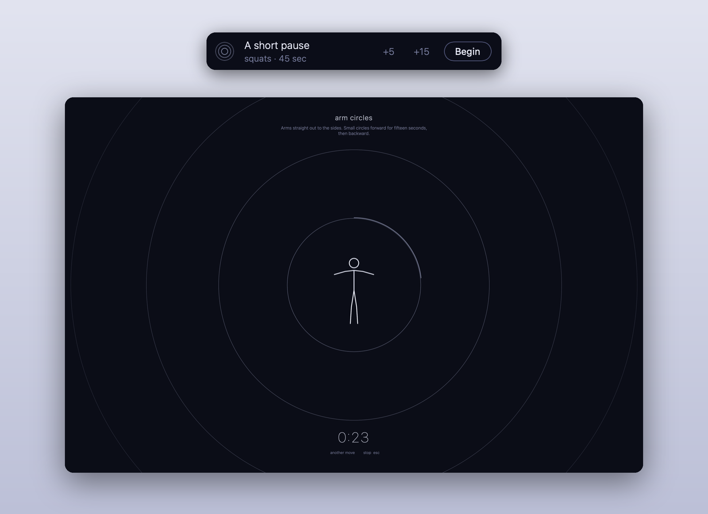

# Exercise Snacks

A macOS menu-bar app that offers a one-to-three-minute exercise snack after about 30 minutes at the Mac.



## How it works

- After 30 minutes of use it waits for a pause in your typing, then shows a small card: **+5**, **+15** or
  **Begin**. Begin fills the screen with the move, a looping figure and a countdown.
- It stays out of calls, full-screen apps, Focus, quiet hours (7pm–7am) and the five minutes before a
  meeting. The end of a meeting, or coming back from lunch, is a good moment for one.
- Every third snack gets you out of breath; the rest are strength and mobility. **not for me** turns a
  move off.
- Respects Reduce Motion, works with VoiceOver and the keyboard, and stays out of screen shares.
  Nothing leaves your Mac.

## Install

Needs macOS 13+ and Xcode or the Swift command-line tools.

```sh
git clone https://github.com/simonwisdom/exercise-snacks.git
cd exercise-snacks
bin/build
cp -R "build/Exercise Snacks.app" /Applications/
open "/Applications/Exercise Snacks.app" --args --open-at-login
```

## Make it yours

Moves live in `~/Library/Application Support/Exercise Snacks/moves.md` (menu: **Edit moves…**), split by `---`:

```markdown
# squats
seconds: 45
figure: squat

Feet shoulder-width apart. Sit back as if into a chair, chest up, then stand.
```

`kind` is `vigorous`, `walk` or left out. `figure` is one of squat, calf, wallpush, march, lunge, jacks,
armcircle, reach, twist, neck, chest.

Quiet hours and the daily limit of 10 cards:

```sh
defaults write com.simonwisdom.exercise-snacks quietFrom -int 19
defaults write com.simonwisdom.exercise-snacks quietUntil -int 7
defaults write com.simonwisdom.exercise-snacks dailyCap -int 10
```

## Development

`swift test` runs the tests. `xcrun swift-format format -i -r Sources Tests Package.swift` formats the code.
`ExerciseSnacks --demo` shows the card, `--demo-full` the full-screen snack.

## Licence

[MIT](LICENSE)
